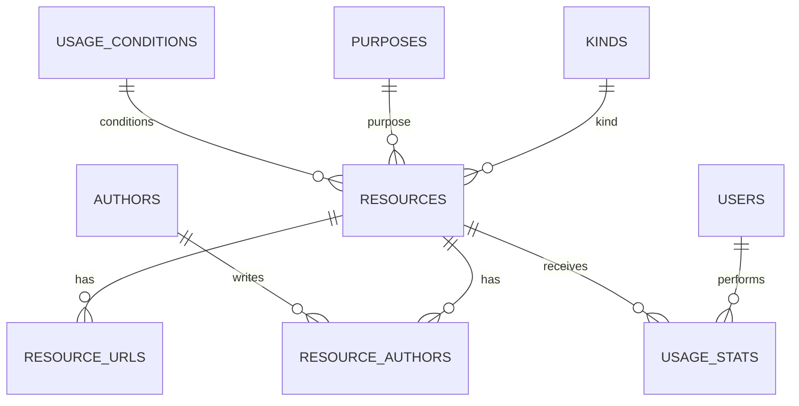
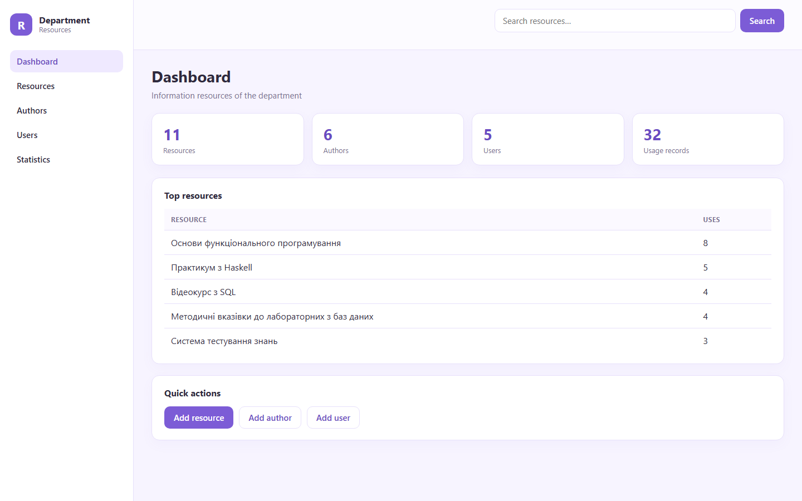
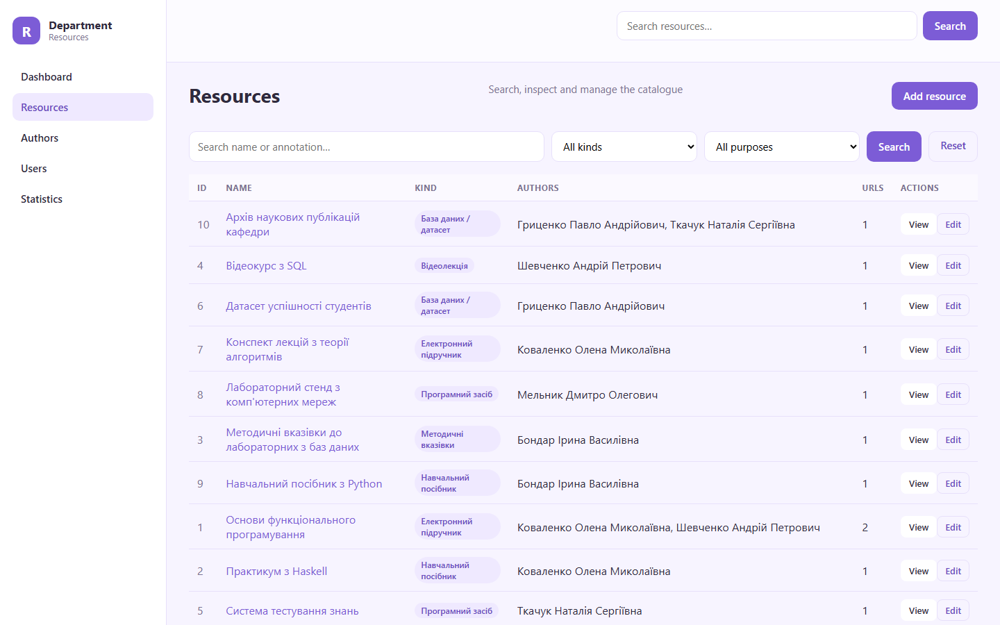
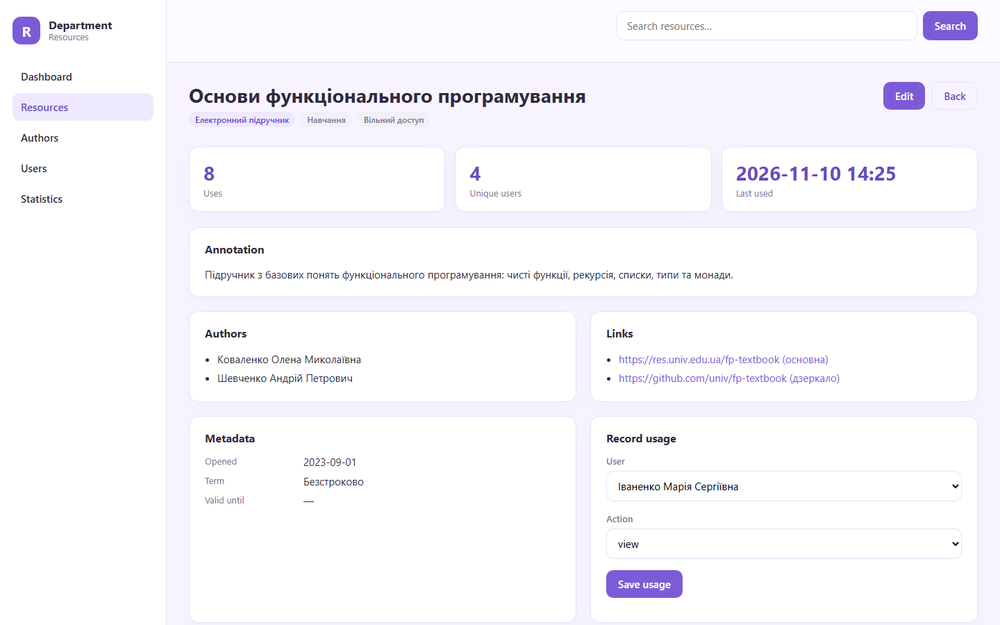
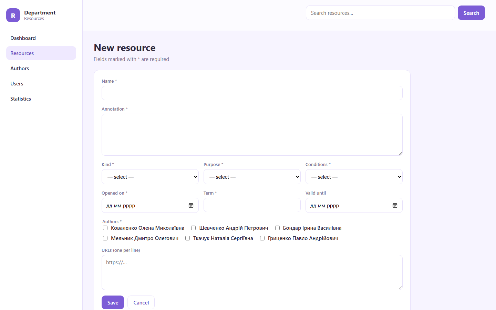
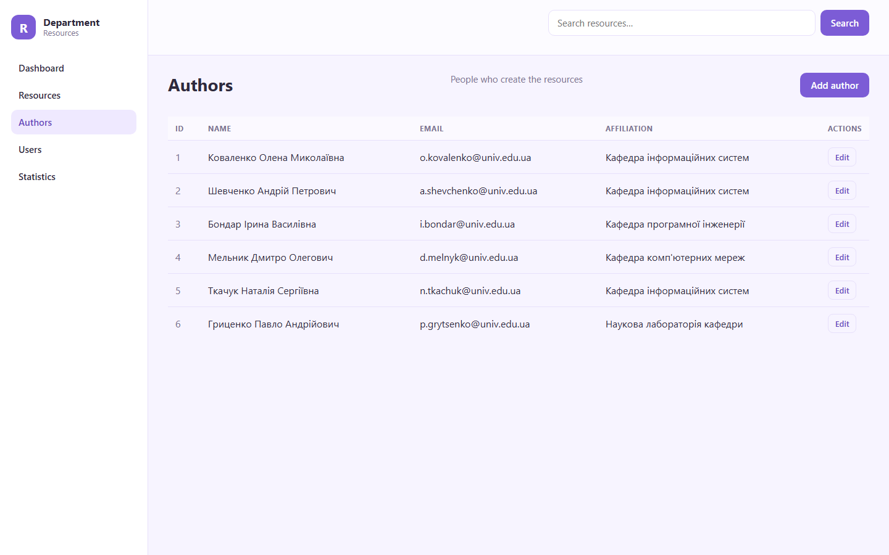
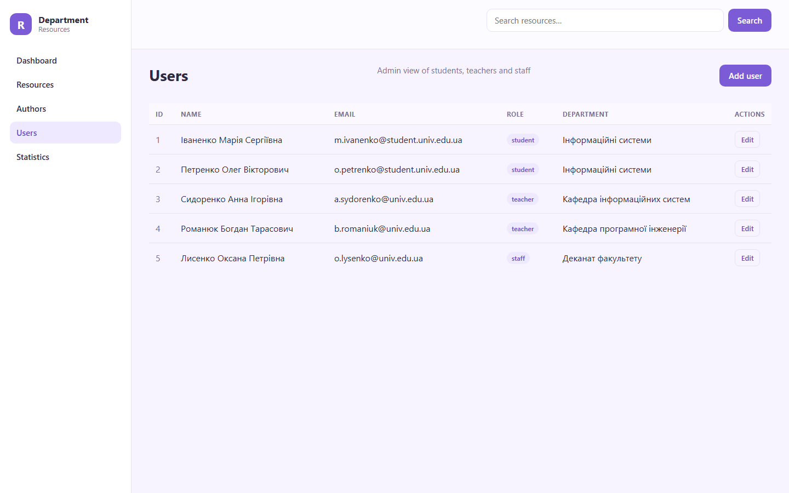
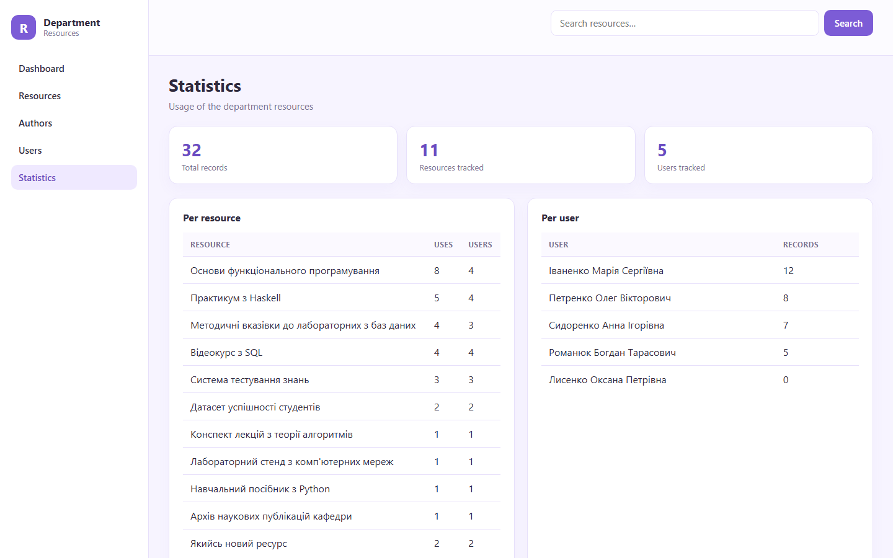

# Lab Work 1 — Variant 1 — Information Resources of the Department

A web information system for managing the information resources of a university
department. Built with **Haskell**, **Scotty**, **Lucid**, and **MySQL**.

The system is an admin dashboard: it stores the department's resources
(textbooks, guides, video courses, software, datasets), their authors, network
addresses, users and usage statistics. Resources can be searched, created,
edited, inspected and deleted.

## 1. What this work is

Implemented features:

- resource catalogue with name, annotation, kind, purpose, usage conditions,
  opening date, usage term, and validity date;
- many-to-many authors per resource;
- multiple network addresses per resource, with a primary URL;
- search by name/annotation and filters by kind and purpose;
- add / view / edit / delete a resource, with authors and URLs saved
  atomically in a transaction;
- author management (create, list, edit);
- user management (students, teachers, staff);
- usage recording and reports: uses, unique users, last used, per-user counts;
- dictionary listings for kinds, purposes, and usage conditions;
- a lilac, server-rendered admin dashboard.

Haskell type classes and instances are central to the data layer:

- `class FromRow a` — decodes a MySQL row into a domain type;
- `class Repository a` — generic `findAll`, `findById`, `deleteById`;
- instances for `Resource`, `Author`, `ResourceUrl`, `Kind`, `Purpose`,
  `UsageCondition`, and `User`.

## 2. Technology stack

| Layer | Technology |
|---|---|
| Language | Haskell, GHC 9.10.3 |
| Build | cabal 3.16 |
| Web framework | Scotty 0.30 (Warp/WAI) |
| HTML | Lucid 2.11 |
| Database | MySQL 8.4 (Docker) |
| MySQL driver | `mysql-haskell` 1.3 (pure Haskell, no C client) |
| Styling | Hand-written CSS, lilac palette, no JavaScript |
| Checks | Manual smoke-test programs under `scripts/` |

**Architecture pattern:** UI → Service → Repository → Db. The web layer never
contains SQL; repositories never print HTML.

## 3. How to start the app

### Requirements

- GHC 9.10.3 and cabal 3.16
- Docker (for MySQL 8.4) or a local MySQL server
- A browser

### 1. Clone the repository

```bash
git clone https://github.com/valeria-chelushkina/func-programming-labs.git
cd func-programming-labs/lab1
```

### 2. Start MySQL

```powershell
docker run -d --name fp-mysql -p 3306:3306 `
  -e MYSQL_ROOT_PASSWORD=root `
  -e MYSQL_DATABASE=dept_resources `
  mysql:8.4
```

If the container already exists:

```powershell
docker start fp-mysql
```

### 3. Create the schema

```powershell
Get-Content .\sql\schema.sql -Raw -Encoding UTF8 |
  docker exec -i fp-mysql mysql --default-character-set=utf8mb4 -uroot -proot dept_resources
```

### 4. Load demo data (optional)

```powershell
$OutputEncoding = [System.Text.Encoding]::UTF8
Get-Content .\sql\seed.sql -Raw -Encoding UTF8 |
  docker exec -i fp-mysql mysql --default-character-set=utf8mb4 -uroot -proot dept_resources
```

**Warning:** `seed.sql` deletes existing rows in all application tables. It
inserts dictionaries, 6 authors, 5 users, 10 resources, their links, and 30
usage records.

### 5. Build and run

```powershell
cabal update
cabal build
cabal run
```

Open **http://127.0.0.1:8080** (or `http://localhost:8080`). Stop the server
with `Ctrl+C`.

The first `cabal build` downloads and compiles the web/MySQL dependencies and
can take several minutes. Later builds are incremental.

Connection settings are in `src/Db/Config.hs` (`127.0.0.1:3306`,
database `dept_resources`, user `root`, password `root`).

## 4. Main architecture

```
lab1/
├── app/Main.hs                  starts the web server
├── src/
│   ├── Web/
│   │   ├── App.hs               routes, form parsing, handlers
│   │   ├── Layout.hs            page shell + lilac CSS
│   │   ├── Components.hs        cards, panels, alerts, form controls
│   │   ├── Forms.hs             form state types
│   │   └── Pages/               one module per page
│   │       ├── Dashboard.hs
│   │       ├── Resources.hs
│   │       ├── ResourceDetails.hs
│   │       ├── ResourceForm.hs
│   │       ├── Authors.hs
│   │       ├── Users.hs
│   │       ├── Stats.hs
│   │       └── NotFound.hs
│   ├── Service/                 use-cases, validation, transactions
│   │   ├── Resource.hs
│   │   ├── Author.hs
│   │   ├── User.hs
│   │   ├── Lookup.hs
│   │   └── Stats.hs
│   ├── Repository/              SQL + FromRow/Repository instances
│   │   ├── Class.hs
│   │   ├── Resource.hs
│   │   ├── Author.hs
│   │   ├── ResourceUrl.hs
│   │   ├── Lookup.hs
│   │   ├── Search.hs
│   │   ├── User.hs
│   │   └── Stats.hs
│   ├── Model/                   pure domain types, no IO
│   │   ├── Resource.hs
│   │   ├── Author.hs
│   │   ├── ResourceUrl.hs
│   │   ├── Lookup.hs
│   │   ├── Filters.hs
│   │   ├── User.hs
│   │   └── Stats.hs
│   └── Db/
│       ├── Config.hs            connection settings
│       └── Connection.hs        withConnection / withTransaction
├── sql/
│   ├── schema.sql               9 tables
│   └── seed.sql                 demo data
├── scripts/                     manual smoke tests
└── docs/screenshots/            UI screenshots
```

| Layer | Responsibility | Must not do |
|---|---|---|
| `Web.Pages` / `Web.Layout` / `Web.Components` | render HTML | query the database |
| `Web.App` | routes, parse forms, call services | build SQL |
| `Service.*` | validation, use-cases, transactions | print HTML |
| `Repository.*` | SQL, row decoding | validate business rules |
| `Db.*` | connect/close, transactions | domain logic |
| `Model.*` | pure types | IO or MySQL |

### Database structure

9 tables



| Table | Purpose | Key columns |
|---|---|---|
| `kinds` | dictionary: resource kind | `id`, `name` |
| `purposes` | dictionary: purpose | `id`, `name` |
| `usage_conditions` | dictionary: access conditions | `id`, `name`, `description` |
| `authors` | people who created resources | `id`, `full_name`, `email`, `affiliation` |
| `resources` | main catalogue | `id`, `name`, `annotation`, `kind_id`, `purpose_id`, `condition_id`, `opened_on`, `term_text`, `valid_until` |
| `resource_authors` | M:N resource ↔ author | `resource_id`, `author_id` |
| `resource_urls` | 1:N resource ↔ URLs | `id`, `resource_id`, `url`, `label`, `is_primary` |
| `users` | students / teachers / staff | `id`, `full_name`, `email`, `role`, `department` |
| `usage_stats` | usage event log | `id`, `user_id`, `resource_id`, `used_at`, `action` |

## 5. Main endpoints

| Method | Path | Purpose |
|---|---|---|
| GET | `/` | dashboard: counts and top resources |
| GET | `/resources` | list + search (`?q=`, `?kind=`, `?purpose=`) |
| GET | `/resources/new` | new resource form |
| POST | `/resources` | create resource |
| GET | `/resources/:id` | details, authors, URLs, usage, delete |
| GET | `/resources/:id/edit` | edit form |
| POST | `/resources/:id` | update resource |
| POST | `/resources/:id/delete` | delete resource |
| POST | `/resources/:id/usage` | record a usage event (`userId`, `action`) |
| GET | `/authors` | author list |
| GET | `/authors/new` | new author form |
| POST | `/authors` | create author |
| GET | `/authors/:id/edit` | edit author form |
| POST | `/authors/:id` | update author |
| GET | `/users` | user list |
| GET | `/users/new` | new user form |
| POST | `/users` | create user |
| GET | `/users/:id/edit` | edit user form |
| POST | `/users/:id` | update user |
| GET | `/stats` | per-resource and per-user usage reports |

## 6. Screenshots

### Dashboard



### Resources: search and filters



### Resource details, usage and links



### Add / edit resource form



### Authors



### Users



### Statistics



## 7. Manual checks

With the server stopped, run the smoke tests from `lab1/`:

```powershell
cabal exec -- runghc -isrc scripts\SmokeCrud.hs
cabal exec -- runghc -isrc scripts\SmokeAuthor.hs
cabal exec -- runghc -isrc scripts\SmokeLookup.hs
cabal exec -- runghc -isrc scripts\SmokeSearch.hs
cabal exec -- runghc -isrc scripts\SmokeUser.hs
cabal exec -- runghc -isrc scripts\SmokeStats.hs
```

Each prints `[PASS]` lines and `ALL ... CHECKS PASSED`, then removes its
temporary rows.
